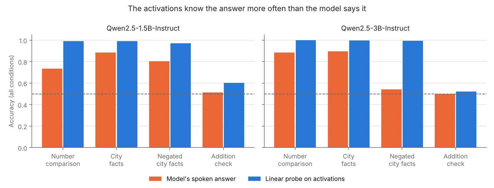
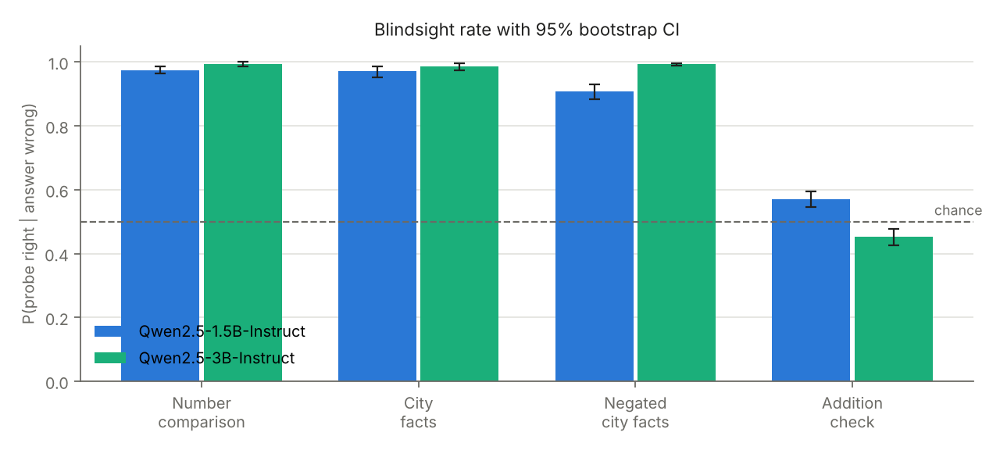
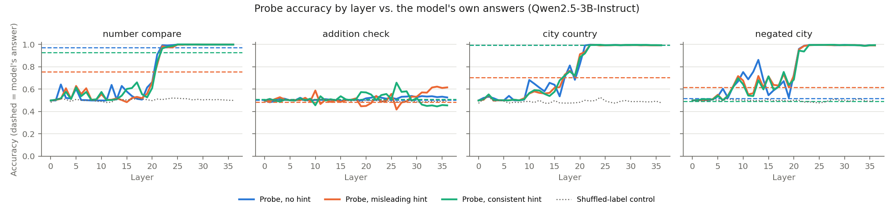
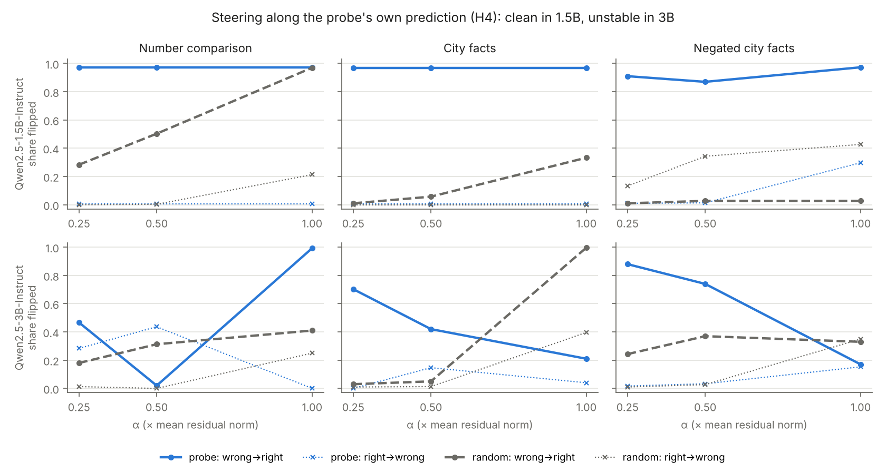

# Machine Blindsight

**Does a language model know more than it says?**

People with *blindsight* (damage to the visual cortex) insist they see nothing in part of their visual field, yet point to objects there far better than chance. Information reaches the systems that guide behaviour but not the systems that support report. This project looks for the same dissociation in large language models: cases where a simple linear probe can read the correct answer out of the model's internal activations while the model's spoken answer is wrong.

> **Result in one line:** in Qwen2.5-1.5B and 3B, when the model answers a question it knows wrongly (usually because of a misleading hint), a linear probe on its activations still has the right answer 91–99% of the time, the model is often less confident on those items, and in the 1.5B model a small push along the probe's direction fixes 91–97% of those errors. [Details](#results).

## Questions and hypotheses

| | Hypothesis | Measured by |
|---|---|---|
| H1 | The best probe is more accurate than the model's own answers on some tasks | `report_gap` = probe accuracy − answer accuracy |
| H2 | When the model answers wrongly, the probe is still right more often than chance | `blindsight_rate` = P(probe right \| answer wrong), bootstrap 95% CI |
| H3 | The model is less confident on blindsight items than on ordinary correct ones | `conf_auroc`: how well confidence separates the two |
| H4 | The hidden information is *usable*: pushing activations along the probe's own prediction fixes errors | wrong→right flip rate vs. a random direction |

Scope: these are measurable *functional analogues* of phenomena studied in consciousness science. Nothing here claims a model is or is not conscious.

## Method

**Tasks** (generated in code, exact ground truth, 1,000 base items each, half true / half false):

| Task | Example |
|---|---|
| `number_compare` | "Is 543 larger than 846?" |
| `addition_check` | "Is 46 + 96 = 142?" (wrong sums are near misses) |
| `city_country` | "Statement: Perth is in Australia. Is this statement True or False?" |
| `negated_city` | "Statement: Istanbul is not in Italy. Is this statement True or False?" |

Each base item appears in three **conditions**:

- *plain*: the question alone;
- *misleading*: plus a hint naming the wrong answer (for example "A classmate who checked this said the answer is No."). This plays the role of a degraded stimulus: it raises error rates so there are enough errors to study;
- *consistent*: plus the same hint naming the right answer.

The consistent condition matters. An earlier version used only misleading hints, and the probe reached 99–100% accuracy on hinted items simply by reading the hint word, which then always revealed the answer. With both kinds of hint, the hint word is statistically independent of the true label, so it cannot leak the answer. Each task has **three prompt templates**.

**Pipeline** (`scripts/run_p1.py`):

1. **Answer.** The model's answer is read from the next-token logits for the two answer words (Yes/No or True/False); confidence is the softmax over just those two.
2. **Activations.** The residual stream at the final prompt token is cached for every layer.
3. **Probes.** For each task and layer, an L2-regularised logistic regression predicts the true label. Evaluation is **leave-one-template-out**, so every probe score comes from a wording the probe never trained on. Both conditions of a base item always share a fold.
4. **Layer choice.** The layer with the best held-out probe accuracy on plain items.
5. **Steering (H4).** Take the mass-mean "truth" direction at that layer (mean of true-item activations minus mean of false-item activations). For each item, add α × (mean residual norm) × direction at every position, with the sign set by the **probe's own prediction**, never the label. Steering can therefore only fix an error when the probe was already right.

**Controls**

- *Shuffled-label control task*: probes trained on permuted labels should sit at chance.
- *Layer-0 baseline*: a probe on token embeddings alone captures surface features of the prompt.
- *Random-initialised model*: the same architecture with random weights, probed at the same layer.
- *Random steering direction*: a random unit vector at the same norm.
- *Unseen templates*: all probe numbers are from held-out wordings.

Known limitation: choosing the layer from out-of-fold accuracy over all layers adds mild optimism to the probe accuracy at that layer.

## Results

Run on Kaggle (2× Tesla T4), 12,000 items per model (4 tasks × 1,000 base items × 3 conditions), 2026-11-11. Cross-model tables: [`results/summary_all_models.csv`](results/summary_all_models.csv), [`results/report_acc_by_condition.csv`](results/report_acc_by_condition.csv), [`results/steering_all_models.csv`](results/steering_all_models.csv), [`results/random_init_control.csv`](results/random_init_control.csv). Full per-model outputs, including every item's answer, confidence and probe score (`items_scored.csv`) and per-layer probe accuracy (`probe_by_layer.csv`), are in `results/<model>/`.

**Headline: in both instruction-tuned models, when the model answers a question it "knows" wrongly, a linear probe on its activations still has the right answer 91–99% of the time.**



| Model | Task | Answer acc. | Probe acc. | Answers wrong | Blindsight rate (95% CI) | Confidence AUROC |
|---|---|---|---|---|---|---|
| Qwen2.5-1.5B-Instruct | Number comparison | 0.736 | 0.990 | 791 | **0.975** (0.963–0.985) | 0.80 |
| | City facts | 0.885 | 0.992 | 344 | **0.971** (0.951–0.985) | 0.94 |
| | Negated city facts | 0.803 | 0.972 | 590 | **0.907** (0.883–0.929) | 0.67 |
| | Addition check | 0.514 | 0.603 | 1,458 | 0.570 (0.545–0.595) | 0.53 |
| Qwen2.5-3B-Instruct | Number comparison | 0.885 | 0.999 | 345 | **0.994** (0.986–1.000) | 0.59 |
| | City facts | 0.897 | 0.996 | 308 | **0.987** (0.974–0.997) | 0.95 |
| | Negated city facts | 0.543 | 0.995 | 1,371 | **0.993** (0.988–0.997) | 0.62 |
| | Addition check | 0.498 | 0.523 | 1,505 | 0.453 (0.427–0.476) | 0.55 |



**Where the information appears.** Truth becomes linearly decodable abruptly, around layer 20–22 of 36 in Qwen2.5-3B, for number comparison, city facts and negated facts alike; before that the probes sit near chance. Nothing becomes decodable for the addition check.



*Solid lines: probe accuracy per layer (held-out wordings). Dashed: the model's own answer accuracy in the same condition. Dotted: shuffled-label control. Per-layer plots for every model are in `results/<model>/figures/`.*

**H1 (report gap): supported** on every task the model can do. The gap is 10–25 points for comparison and city facts, and 45 points for negated city facts in the 3B model. That last gap comes from a response bias, not confusion about negation: on plain negated statements the 3B model answers "False" 98% of the time, whatever the truth, while the probe at layer 24 is 99.6% accurate.

**H2 (blindsight): supported.** Most errors come from the misleading hint. For example, Qwen2.5-1.5B answers plain city questions 99.5% correctly but only 66% with a misleading hint, yet the probe stays at 99% on those hinted items.

**The effect needs real knowledge.** On the addition check, neither the answers nor the probes beat chance by much, and the blindsight rate is near 50%. The probe does not "know" things the model does not know.

**H3 (lower confidence on blindsight items): mostly supported.** The model's confidence separates ordinary correct answers from blindsight errors with AUROC 0.94–0.95 on city facts and 0.80 on number comparison (1.5B). It is weaker for the 3B model on number comparison (0.59) and absent on the addition check. AUROC here is the probability that a random correct item has higher confidence than a random blindsight item.

**H4 (causal access): supported in Qwen2.5-1.5B, unstable in Qwen2.5-3B.**



- *Qwen2.5-1.5B:* pushing along the probe's own prediction at the smallest strength (α = 0.25) fixes 97% of wrong answers on number comparison and city facts, and 91% on negated facts, while breaking at most 1% of right answers. A random direction at the same strength fixes 28%, 1% and 1%. Larger random pushes also fix many number-comparison errors (97% at α = 1, but breaking 21% of right answers), which suggests errors caused by the misleading hint are fragile to any perturbation. The probe direction's advantage is that it works at low strength and specifically.
- *Qwen2.5-3B:* at α = 0.25 the probe direction beats random on city facts (70% vs 3% fixed) and negated facts (88% vs 24%). At larger strengths results are non-monotonic (for example, city facts drop to 21% at α = 1), which points to the push taking the model off-distribution. A finer, smaller α sweep is the obvious next step.

**Controls behaved as they should.** Shuffled-label probes: 0.48–0.52. Random-weight copies of the models (Pythia, 1.5B): 0.50–0.54. All probe numbers are on prompt wordings the probe never saw.

**Pythia-410M (base model) is a non-result**: it answers every task at chance (it essentially always picks the same word), so its "blindsight rate" just reflects the probe's moderate accuracy (0.52–0.79). It shows the effect needs a model that can follow the answer format.

### Caveats

- **Negated facts are confounded.** Within the negated task, every question contains "not", so a probe can succeed by reading the plain fact ("is Lyon in France?") and flipping it. The 3B result shows the model encodes the fact, not that it internally computed the negation, and its errors there are mostly a blanket "False" bias rather than item-by-item mistakes.
- **Layer choice adds mild optimism.** The probe layer is the one with the best held-out accuracy on plain items.
- **The layer-0 baseline (0.50) is uninformative**: the final token is identical across prompts of one template, so its embedding carries nothing. The random-weights model is the meaningful surface-feature control. It was run for Pythia and the 1.5B model only.
- **Two model sizes from one family**: claims about scale would need more models.

## Reproduce

On Kaggle: import `notebooks/kaggle_p1.ipynb`, set Accelerator to **GPU T4 x2** and Internet **on**, then Run All. Locally with a GPU:

```bash
pip install -r requirements.txt
python scripts/run_p1.py --model Qwen/Qwen2.5-1.5B-Instruct --out results/qwen2.5-1.5b-instruct --random-init-control
```

Outputs per run: `summary.csv`, `probe_by_layer.csv`, `steering.csv`, `items_scored.csv`, `random_init_control.csv`, `run_meta.json` and `figures/`.

## Repository layout

```
src/datasets.py   task generation (templates, hints, labels)
src/model.py      model loading, answer reading, activation caching
src/probes.py     leave-one-template-out probes, controls, mass-mean direction
src/steering.py   forward hooks for the causal-access test
src/analysis.py   metrics, bootstrap CIs, figures
scripts/run_p1.py end-to-end experiment for one model
scripts/make_summary_figures.py  cross-model figures from results/*.csv
notebooks/        Kaggle runner
results/          cross-model tables and figures; results/<model>/ holds each run's full output
```

## Related work

- Weiskrantz, *Blindsight: A Case Study Spanning 35 Years and New Developments*
- Block (1995), "On a confusion about a function of consciousness"
- Alain & Bengio (2016), "Understanding intermediate layers using linear classifier probes"
- Hewitt & Liang (2019), "Designing and Interpreting Probes with Control Tasks"
- Burns et al. (2022), "Discovering Latent Knowledge in Language Models Without Supervision"
- Azaria & Mitchell (2023), "The Internal State of an LLM Knows When It's Lying"
- Marks & Tegmark (2023), "The Geometry of Truth"
- Fleming & Lau (2014), "How to measure metacognition"

## Author

Pranav Sai Kosaraju, B.Tech CSE, Mahindra University.
